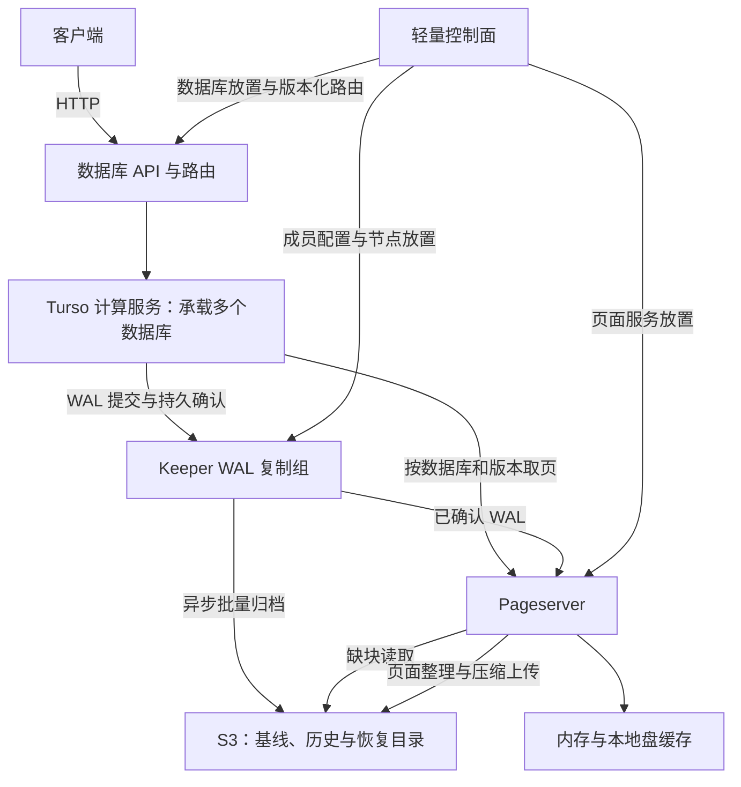

# turso-serverless


本项目希望通过 Turso 已有的存储扩展接口，以零改造或少量改造实现计算与存储分离：数据库的长期权威数据持久化于 S3，计算与页面服务可以按需启动、扩缩容和重建。多个数据库共享实例、缓存和对象存储上传资源，并通过 HTTP 对外提供数据库服务。

接入优先使用 `Database::open` 与 `OpenOptions::storage`，在引擎外实现存储适配器、日志持久化、页面服务和管理接口。当前验证所用 Turso 源码无需修改；后续若现有接口无法表达必要的提交或恢复语义，再引入范围明确的少量改动。采用普通 WAL 模式。

## 项目目标

1. **权威数据持久化于 S3。** S3 保存恢复所需的基线、WAL/页面历史、不可变对象和已发布目录。数据库可以从 S3 的完整恢复点重建，数据库与历史身份不绑定某台机器或某块盘。
2. **读取时，本地盘仅作为缓存加速。** Pageserver 按需从 S3 读取页面所需的数据块，使用内存和本地盘缓存热点数据；缓存可淘汰、可丢弃、可重建。读取最新提交还需要合并已确认而尚未归档的 WAL，不能只读取较旧的 S3 状态。
3. **通过 Keeper 持久化 WAL 降低提交等待。** 写入先进入 Keeper 复制组，在满足持久化多数确认（quorum）后确认事务，再异步批量归档至 S3。S3 的单次上传延迟不进入默认事务确认路径；跨库合包进一步减少小对象写入请求。这里降低的是事务等待 S3 的延迟，并不改变 S3 自身的请求延迟。
4. **对外提供 HTTP 协议访问。** 提供数据库 SQL 执行、事务会话和数据库管理入口，由服务层完成身份校验和数据库路由。外部 API 与内部页面/WAL 协议独立设计，HTTP 事务会话需要保持原有事务语义。
5. **单个实例/pod 承载多个数据库。** 每库保留独立身份、WAL 顺序、事务状态和历史；实例共享执行资源、连接管理、缓存与归档 worker。按需加载和闲置卸载减少常驻开销，并对单库资源使用设置预算。首版每库采用一个计算写入者。
6. **支持时间回溯。** 保留基线、完整提交历史及提交时间到日志位置的索引，在配置的保留窗口内读取或恢复某个已提交状态；从旧位置继续写入时创建独立历史。compaction 保留有效历史，GC 根据保留策略和活跃引用回收数据。

## 整体架构与持久化语义

以下是目标架构，Keeper 和 HTTP 入口尚未接入当前原型。



**S3 已发布恢复目录与 Keeper 尚未归档的已确认 WAL，共同确定最新可恢复状态。** S3 承担长期存储，Keeper 承担短期写入持久性；只有 S3 发布已经覆盖某段 WAL，并满足恢复与历史保留条件后，Keeper 才能回收它。本地读缓存不承担提交持久性；Keeper 持久日志和写入暂存区具有不同职责，不能作为普通缓存删除。

| 提交策略 | 客户端确认条件 | 故障后的恢复边界 |
| --- | --- | --- |
| 默认：Keeper quorum | WAL 达到复制组所需的持久确认 | 在设计容忍的副本故障范围内保留已确认提交；整个 Keeper 组永久丢失时只能恢复 S3 已发布前缀 |
| 可选：quorum + S3 | WAL 持久确认，且 S3 恢复目录覆盖本次提交 | 可从 S3 恢复该提交，提交延迟包含 S3 发布等待 |
| 当前原型 | 单 Pageserver 本地 fsync 和 manifest 发布 | 进程重启保留已确认历史；本地盘永久丢失时可能丢失完整未归档尾部 |

页面服务从固定版本的数据重建页面，按需查询已确认日志。Pageserver 节点的本地读缓存可以全部丢弃后重建。当前原型仍将写入权威状态和页面服务放在同一 Store 内；拆出 Keeper 后才能达到目标架构的节点职责与故障边界。

## 配套能力

上述六项目标还需要以下能力支撑：

- **节点切换与写入者隔离。** 动态下发 Keeper 成员和 Pageserver 地址，支持故障重连、成员调整、页面服务迁移；使用版本化路由和写入 epoch 隔离旧节点，避免切换后双写。
- **完整事务恢复与安全重试。** 恢复只安装完整、连续且校验通过的提交；超时或丢回复可查询结果，并通过持久请求身份避免重复执行。
- **降低对象存储成本。** 跨库批量上传、独立块压缩、按范围读取和后台 compaction；正常读写、目录发布与整理通过明确对象 key 完成，避免依赖 LIST 扫描。
- **历史保留与安全回收。** 长读事务和历史恢复固定版本；GC 保护保留窗口、活跃读者、分支及待发布对象。删除一个库不能误删共享 pack 中其他库的数据。
- **多库资源隔离与背压。** 对缓存、连接、内存、日志积压和后台 I/O 设置预算；S3 长时间不可用时，根据积压水位控制写入，避免无限消耗 Keeper 空间。
- **克制使用管理数据库。** 控制面仅持久化节点、数据库放置、路由和必要管理操作；页面读写、WAL 提交、归档目录发布和普通 compaction 不逐次访问管理数据库。
- **兼容性与可观测性。** 持续对照原始 Turso 用例，覆盖事务、checkpoint、VACUUM、ATTACH 和故障恢复；观测确认位置、归档位置、缓存命中率、S3 请求数与后台整理成本。

历史克隆/分支和按负载迁移可以在这些基础能力上扩展。跨库合包只共享物理对象和上传请求，各库的提交顺序独立；它不提供跨库分布式事务。

## 当前实现进度

| 能力 | 当前状态 |
| --- | --- |
| Turso 存储接口接入 | 固定版本源码零改造，通过自定义存储适配器接入 |
| S3 数据与恢复目录 | 已实现跨库 pack、不可变目录发布和完整前缀恢复；上传异步 |
| 按需读取与本地缓存 | 已实现 Range GET、块校验、缓存淘汰与可写冷启动 |
| 写入持久化 | 已实现单 Pageserver 本地持久发布；Keeper quorum 待实现 |
| HTTP 访问 | 待实现；当前 SQL 探针与页面服务使用内部 loopback TCP 协议 |
| 单 pod 多库 | 已验证跨库归档与测试路由；通用多库服务、调度和容量隔离待实现 |
| 时间回溯 | 已保留页面版本与归档 revision，可恢复旧 revision；时间索引、保留窗口和在线分支待实现 |
| 后台 compaction | 已实现 pack 重打包并检查发布版本；独立页面 image/delta 整理待实现 |
| 节点切换与 GC | Keeper、自动接管、写入者隔离、持久请求去重及 GC 待实现 |

当前依赖 [Turso v0.8.2](https://github.com/tursodatabase/turso/releases/tag/v0.8.2)，通过 Git submodule 固定为 `5c168be5ef6a32ac966daf5983502a4f694b37ad`。原型每库仅允许一个计算写入者，文件锁为空实现；尚未提供认证、多节点复制或生产容量承诺。文件、对象和目录采用 POSIX fsync 屏障，硬件断电尚未验证。

TRUNCATE、RESTART 和 VACUUM 复用 WAL 前会校验已同步 DB 对已发布页面的完整覆盖，先发布新基线和代际；旧对象与历史版本保留。读者使用固定代际和提交位置，后台 pack compaction 不改变逻辑数据版本。

## 构建与验证

在本目录执行：

首次获取源码可使用 `git clone --recurse-submodules https://github.com/krun-dev/turso-serverless.git`；已有检出运行 `./setup.sh` 初始化子模块。

项目提供源码，不附带预编译二进制。`build.sh` 自动创建 `bin/` 并生成服务和验收工具；`bin/` 与 Rust 的 `target/` 均为忽略的本地构建产物。

```sh
./setup.sh
./build.sh
./run.sh
./run-storage-tests.sh
./run-cloud-e2e.sh
```

`run.sh` 编译、检查 Rust 格式，并验证 10 组 WAL/页面、2 个反例和 5 组代际测试。`run-storage-tests.sh` 验证 24 组归档和 23 组冷读写；加 `--oss` 使用实际阿里云 S3 兼容端点。`run-cloud-e2e.sh` 执行全部安全检查、完整官方 SQL、STRICT 补充、原样 TODO 诊断及持久库变体，最后按逐例身份核对覆盖率。`run-official-e2e.sh` 指向同一完整入口。

需要 Git、Go 和带 rustfmt 的 Rust stable 工具链。构建依赖由 `pageserver/go.mod`、`go.sum`、`Cargo.lock` 和 Turso submodule 固定；页面服务最低编译器版本为 1.24，验证使用 Go 1.26.9 和 Rust 1.99.0。`setup.sh` 初始化 `.deps/turso` 并校验主仓库记录的提交，测试脚本自动准备该依赖。已有本地 `.rustup`、`.cargo` 时使用它们，否则使用系统安装的 rustup/cargo。

升级 Turso 时更新子模块提交、`Cargo.lock`、`source-manifest.json` 和对应版本的验收基线，再运行完整对照；主仓库提交记录具体源码版本。

运行使用唯一证据目录和随机 loopback 端口。强杀、损坏注入及目录删除只针对本次 fixture。对象存储配置通过 `S3_ENDPOINT`、`S3_BUCKET`、`S3_PREFIX` 和 `S3_REGION` 提供，凭证从 `AWS_ACCESS_KEY_ID` / `AWS_SECRET_ACCESS_KEY` 读取。外部存储测试要求显式配置端点、桶和前缀，每次写入 `${S3_PREFIX}/runs/<唯一 ID>/...`。`--oss` 选择阿里云防覆盖模式，端点须为 S3 兼容地址。配置未设置时拒绝外部测试；凭证不写入参数、代码或证据。

单独执行静态与并发检查：

```sh
cd pageserver
go test -race ./...
go vet ./...
```

默认单元测试不启动引擎。真实引擎验证需 `PAGESERVER_INTEGRATION=1`，脚本自动设置；实际对象存储安全检查另设置 `PAGESERVER_TEST_OSS=1`。缺少任何一组检查都会失败。

## 服务与归档入口

`bin/pageserver` 提供 `server`、`cold` 和 `archive` 入口。归档要求 Store 已通过 baseline 管理操作初始化，并使用 FULL WAL。后台 worker 示例：

```sh
./bin/pageserver archive watch \
  --service s3 --create-mode oss-forbid-overwrite \
  --endpoint "$S3_ENDPOINT" --region "$S3_REGION" \
  --bucket "$S3_BUCKET" --prefix "$S3_PREFIX" \
  --group group1 --state /tmp/turso-group1-archive-state \
  --db db_a=/absolute/path/to/store-a \
  --db db_b=/absolute/path/to/store-b --interval 5s
```

同样的配置支持 `flush`、`compact`、`inspect`；`restore --destination /absolute/new-root` 创建包含各库子目录的新恢复根，可加 `--revision 1`。恢复目标须全新且独占；恢复旧 revision 后继续写入应使用新历史/归档前缀。

```sh
./bin/pageserver cold \
  --root /absolute/new-cold-root --service s3 --create-mode oss-forbid-overwrite \
  --endpoint "$S3_ENDPOINT" --region "$S3_REGION" \
  --bucket "$S3_BUCKET" --prefix "$S3_PREFIX" \
  --group group1 --database db_a
```

服务统一使用 S3 客户端和通用 Backend 接口。标准 S3 条件创建为 `--create-mode s3` 的 `If-None-Match: *`；阿里云兼容端点使用 `--create-mode oss-forbid-overwrite` 的防覆盖头。普通 PUT/GET/Range 和数据布局相同。原子创建能力须实测，不能降级成普通覆盖写。

当前每批单 pack 目录发布包含 pack、manifest、commit、CURRENT 四次逻辑写，空批次不写。块大小为 64 KiB，pack 上限 64 MiB，commit 原子创建限于不超过 16 KiB 的小对象。磁盘缓存每目录 128 MiB，进程内缓存总计 128 MiB；页面索引和整批打包的容量管理仍需改进。

## 代码导航

| 路径 | 职责 |
| --- | --- |
| `pageserver/` | WAL/页面服务、S3 访问、归档、compaction 与可写冷启动 |
| `pageserver/*_integration_test.go` | 真实引擎、安全边界和故障恢复验证 |
| `pageserver/cmd/verify/` | 官方用例编排与逐例覆盖率汇总 |
| `src/lib.rs`、`src/main.rs` | 计算侧存储适配器和 SQL 探针 |
| `src/bin/official-e2e.rs`、`src/bin/support/file_backend.rs` | 原始官方 SQL harness 接入 |
| `build.sh` | 在本地生成服务/worker 与验收执行文件 |

## 验收证据与设计文档

保留证据中的真实桶、内网端点和对象前缀已脱敏，测试结果与逐例记录保留。包含实际存储绑定的旧实验恢复目录已删除；它们不能用于原地续跑，复现实验需重新生成 fixture。

仓库的 `docs/evidence/` 提供脱敏验收摘要。完整逐例记录和实验数据库保留在本地忽略的 `evidence/`，不随源码发布；克隆后运行测试重新生成，完整覆盖率汇总需要本次运行产生的原始记录。

完整官方批次保留原始 SQL、矩阵、EXPLAIN 快照和 SQLite 完整性检查，不更新预期。当前 v0.8.2 内存与实际 S3 后端验收均为：16,182 例中 15,836 通过、346 跳过、0 失败/错误；STRICT 补充 342 例通过，原样 TODO 两例通过、两例受上游内存 VACUUM 限制，四个持久库变体通过。按逐例身份核对，共 16,180 个原始用例通过。内存与实际 S3 各通过 24 组归档和 23 组冷读写检查，标准链路与对象存储链路逐例结果一致。

v0.8.2 已重新验证 64 组核心安全检查、完整内存与实际 S3 语料及补充批次。此前开发提交 `8cc059bd951551ae4b9dc31c01146a24b3e87a51` 的内存与实际 S3 验收为 20,905 例，摘要仍保留在 `docs/evidence/` 顶层；不同源码提交的用例数量不同，验收工具拒绝混用版本。当前版本摘要位于 `docs/evidence/release-v0.8.2/`。范围不含 CLI/TCL、其他语言 binding、完整 Rust integration 或分布式 simulator；此前 Linux amd64 已交叉编译，Linux 节点执行尚未验收。

- [v0.8.2 内存完整验收](docs/evidence/release-v0.8.2/cloud-acceptance-memory-latest.json)
- [v0.8.2 实际 S3 完整验收](docs/evidence/release-v0.8.2/cloud-acceptance-oss-latest.json)
- [v0.8.2 归档安全检查](docs/evidence/release-v0.8.2/archive-memory-latest.json)
- [v0.8.2 冷读写安全检查](docs/evidence/release-v0.8.2/cold-memory-latest.json)
- [历史实际 S3 完整验收](docs/evidence/cloud-acceptance-oss-latest.json)
- [S3 原子创建探针](docs/evidence/s3-probe-latest.json)
- [S3 并发防覆盖验证](docs/evidence/s3-concurrent-oss-latest.json)
- [入口清理与回归记录](docs/evidence/cleanup-latest.json)
- [v0.8.2 升级与复现检查](docs/evidence/release-v0.8.2/upgrade-checks.json)

项目详细设计见 [Turso 接入](docs/turso-wal-pageserver-design.md)、[Keeper 与 S3 协议](docs/turso-pageserver-keeper-s3-design.md)、[跨库 pack 与元数据](docs/turso-pageserver-pack-metadata-design.md)、[对象存储访问层](docs/turso-pageserver-object-storage-design.md) 和 [官方用例兼容性](docs/turso-wal-pageserver-compatibility.md)。
