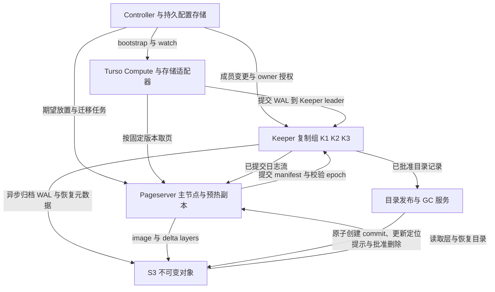

# Turso WAL Pageserver Keeper 与 S3 设计

本方案沿用 Turso 普通 WAL 和单计算写入者，将提交持久性与恢复交给 Keeper，将按版本取页和页面整理交给 Pageserver，最终把可恢复的数据与元数据存入 S3。Keeper 地址和 Pageserver 地址都支持动态下发；连接故障、Keeper 成员变更、Pageserver 迁移分别处理，使用独立版本号保证旧节点不会继续推进权威状态。

当前首版采用单 Pageserver、本地持久 WAL 和异步 S3 跨库 pack，允许丢失未归档的完整事务尾部。外部数据库仅用于节点、放置路由和必要管理操作，目录发布使用原子创建的不可变 commit，CURRENT 作为定位提示。具体边界见 [跨库归档与元数据库设计](turso-pageserver-pack-metadata-design.md)。本文描述后续 Keeper 阶段；下面的逐库对象路径表示逻辑分类，共享 pack 通过组级 manifest 的 extent 引用映射，不要求每库每轮独立上传对象或更新 CURRENT。

这是目标协议设计。当前 [实验](../README.md) 已验证 WAL 多代际、VACUUM 和旧版本页面读取，并接入 S3 跨库 pack、按需对象存储读取和可写冷启动；尚未实现本文的 Keeper 复制、节点切换或独立 image/delta 层格式。本文的 Keeper 指承担 WAL 持久化的服务，角色对应 Neon Safekeeper。

## Neon 的参考机制

Neon 的计算节点通过 WAL proposer 等待 Safekeeper quorum 后确认提交；Pageserver 消费日志并按版本提供页面。借鉴的是持久日志与页面服务的分工，SQLite WAL 本身保存完整页镜像，不需要接入 PostgreSQL redo。[Neon WAL 协议](https://github.com/neondatabase/neon/blob/fa504217c61bbcaf5c512d75830564541f917f8f/docs/safekeeper-protocol.md)。

Neon 的 ComputeSpec 包含 Keeper 连接串与成员配置版本；配置数据结构以节点 ID 定义成员，同时携带连接地址。连接线索和投票资格是不同概念。[ComputeSpec](https://github.com/neondatabase/neon/blob/fa504217c61bbcaf5c512d75830564541f917f8f/libs/compute_api/src/spec.rs#L137)、[membership 类型](https://github.com/neondatabase/neon/blob/fa504217c61bbcaf5c512d75830564541f917f8f/libs/safekeeper_api/src/membership.rs)。

Neon 的动态成员变更采用旧、新集合共同参与的过渡配置。RFC 给出设计，对应 Storage Controller 代码已包含迁移流程；具体恢复位置计算应以实现为准，不能直接把旧 RFC 的伪代码当作实现。[成员变更 RFC](https://github.com/neondatabase/neon/blob/fa504217c61bbcaf5c512d75830564541f917f8f/docs/rfcs/035-safekeeper-dynamic-membership-change.md)、[迁移实现](https://github.com/neondatabase/neon/blob/fa504217c61bbcaf5c512d75830564541f917f8f/storage_controller/src/service/safekeeper_service.rs#L1121)。

Neon 的 Storage Controller 管理放置、attachment generation 和迁移；Storage Broker 发布位置与进度信息，用于选择日志来源。Broker 信息帮助发现节点，不替代共识确认。[Storage Controller](https://github.com/neondatabase/neon/blob/fa504217c61bbcaf5c512d75830564541f917f8f/docs/storage_controller.md)、[Storage Broker](https://github.com/neondatabase/neon/blob/fa504217c61bbcaf5c512d75830564541f917f8f/docs/storage_broker.md)。

Neon 用不可变 image/delta layers 表达页面历史，remote index 保存对象引用和进度；对象关联写入时的 generation，删除队列检查代际资格。本文采用相同的层次划分，文件格式和接口为我们的设计。[页面存储](https://github.com/neondatabase/neon/blob/fa504217c61bbcaf5c512d75830564541f917f8f/docs/pageserver-storage.md)、[远端索引](https://github.com/neondatabase/neon/blob/fa504217c61bbcaf5c512d75830564541f917f8f/pageserver/src/tenant/remote_timeline_client/index.rs#L22)、[删除队列](https://github.com/neondatabase/neon/blob/fa504217c61bbcaf5c512d75830564541f917f8f/pageserver/src/deletion_queue.rs#L38)。

## 组件与提交边界



| 组件 | 负责什么 | 权威边界 |
| --- | --- | --- |
| Controller | 节点登记、Keeper/Pageserver 放置、路由快照、持久迁移任务和重试 | 保存期望状态；不能用改路由代替日志共识和 fencing |
| Keeper | 复制已提交 WAL、提交位置、writer fencing、代际切换、manifest 批准、恢复 | 提交与版本发布的权威；接纳命令时校验 owner 和前置状态 |
| Pageserver | 从已提交日志建立页面版本，取页、压缩、image/delta 生成与预热 | 可重建的数据服务；当前 owner 才能申请发布新 manifest |
| S3 | 保存 WAL 归档、页面层、manifest、可独立恢复的目录 | 不可变对象是数据；被批准的目录决定哪些数据对外可见 |
| 目录发布与 GC 服务 | 将 Keeper 已批准目录落入 S3，执行已批准删除 | 可与 Keeper/Controller 共部署，但 Pageserver 无权创建 commit、更新 CURRENT 或 DELETE |

接入 Keeper 后，建议其内部使用成熟 Raft 复制日志。客户端连接组内任意节点，由它重定向到 leader；复制、选举、learner 和联合成员变更由共识实现承担。这里与 Neon 的 compute proposer 形态有区别：计算节点不自己执行 Keeper 投票和多数确认。需要选择支持持久状态、snapshot 和安全成员变更的实现，不能以“并发写三份、收到两份回复”替代共识协议。[Raft 论文](https://raft.github.io/raft.pdf)。

初始配置为三个 Keeper voter，分散到独立故障域。正常提交等待 leader 与满足当前配置的多数副本持久确认。Pageserver 应用和 S3 归档异步进行；计算节点需要缺页时仍依赖可读 Pageserver，不能理解为 Pageserver 故障时所有写操作均可继续。

“最终在 S3”采用异步归档默认语义：一个 Keeper 故障不丢已确认提交，但整个复制组同时永久丢失时，只能恢复 S3 已完成发布的前缀。若要求这种故障也不丢已确认提交，必须增加 `quorum_and_s3` 模式，客户端确认同时等待覆盖该提交的 S3 恢复目录发布。不能把两种故障承诺混为一谈。

## 身份与版本

| 字段 | 谁推进 | 用途 |
| --- | --- | --- |
| `db_id / timeline_id` | Controller 创建 | 数据库与历史身份；恢复分支创建新 timeline，避免旧节点写入新历史 |
| `route_revision` | Controller 持久 CAS | 整份地址快照的顺序，避免延迟通知把客户端配置回滚 |
| `membership_version` | Keeper 已提交成员配置 | 投票成员与 joint 阶段；不能由客户端地址列表决定 |
| `raft_term` | Keeper 共识实现 | leader 选举与日志恢复；不是计算节点的写入权限 |
| `writer_epoch` | Keeper 提交授权的 owner 切换 | 隔离旧 Compute；Keeper leader 更换不必更换 Compute owner |
| `wal_generation` | Keeper 提交代际切换记录 | SQLite WAL 重置/盐值变化；与成员配置、leader term 无关 |
| `data_seq` | Keeper 在 timeline 内确定顺序 | 已提交 WAL 与代际记录的单调位置；跨 WAL frame 复用仍能比较 |
| `ps_epoch` | Controller 提议，Keeper 提交 attachment fence | 隔离旧 Pageserver 的元数据发布和整理操作 |
| `manifest_revision` | Keeper 批准目录变更 | 单调的 manifest 发布顺序；物理层重排不改变页面逻辑版本 |

物理节点另有 `node_id + incarnation`。相同节点换 IP 可只更新地址；丢失持久状态的节点作为新 incarnation/learner 恢复，不带着空盘继续冒充已同步 voter。地址通过认证映射到节点身份，同一节点多个连接只能算一个成员。

## Keeper 列表与 Pageserver 地址下发

Compute 启动配置只固定 Controller 的 bootstrap 地址、数据库/历史 ID 和凭证。Controller 提供 `GetStorageRoute` 与 `WatchStorageRoute(after_revision)`；Compute 和 Pageserver 都订阅。首次返回完整快照，之后返回带版本的完整替换或可校验增量；watch 断开重连先补快照，不能假定消息恰好送达一次。

示例是我们的接口形状，地址为占位值：

```json
{
  "format_version": 1,
  "db_id": "db_7",
  "timeline_id": "tl_main",
  "route_revision": 82,
  "keeper_group_id": "kg_9",
  "membership": {
    "version": 14,
    "phase": "stable",
    "voters": ["k1", "k2", "k3"],
    "next_voters": [],
    "learners": []
  },
  "keeper_endpoints": [
    {"node_id": "k1", "incarnation": 4, "endpoint": "https://k1.invalid:7400"},
    {"node_id": "k2", "incarnation": 2, "endpoint": "https://k2.invalid:7400"},
    {"node_id": "k3", "incarnation": 7, "endpoint": "https://k3.invalid:7400"}
  ],
  "leader_hint": "k1",
  "pageserver": {
    "shard_id": 0,
    "mapping_revision": 1,
    "ps_epoch": 23,
    "primary": {"node_id": "p1", "endpoint": "https://p1.invalid:7500"},
    "secondaries": [{"node_id": "p2", "endpoint": "https://p2.invalid:7500"}]
  },
  "object_prefix": "v1/tenants/t1/databases/db_7/timelines/tl_main/"
}
```

下发的 membership 是最近观察到的已提交配置副本，`leader_hint` 和健康状态只是提示。Keeper 握手返回实际配置；客户端只接受同组、经过认证且版本更高的信息。旧版本消息、watch 乱序和 Controller 重启不降低本地版本。DNS/VIP 可以帮助建立连接，不能把一个 VIP 后的随机实例当作多个 voter。

当收到 `NotLeader`、`ConfigChanged`、`WrongAttachment` 或节点不可达时，连接层重选节点并刷新路由。地址更新可以热应用；不修改事务已经固定的页面版本。Controller 暂不可用时，现有客户端可继续使用已知 Keeper 组和 owner，前提是存储侧仍接受该身份；新建 owner、成员变更和 Pageserver 晋升暂停。证书/授权本身到期时按授权规则停止，不能靠缓存配置无限续权。

状态发现首版可复用 Controller 的 watch/状态流。活跃库多时再拆出类似 Neon Broker 的非权威服务，按 timeline/group 多路复用消息与连接；它发布节点进度帮助选择 WAL 来源，但没有权限授予成员或推进 commit。

## Keeper 故障与成员切换

### 连接故障与 leader 更换

单个 Keeper 暂时不可达时不改变成员集合。剩余两个 voter 达成多数便可继续；leader 故障由 Raft 选举处理，Compute 根据重定向或候选地址恢复连接。相同 Compute 的 `writer_epoch` 保持不变。

每个提交携带 `request_id`、`expected_previous_seq`、内容摘要和 writer epoch。Keeper 把去重结果与 WAL 在同一共识命令内保存；相同 ID 和相同 payload 返回同一结果，不同 payload 拒绝。丢回复后客户端只查询结果或重发同一存储命令，不能自动重新执行 INSERT 等 SQL。结果查询使用 leader 的线性一致性读或已验证的提交凭据，不能把落后副本的“未找到”当作回滚。

多数字段不一致、缺少 quorum 或 leader 未完成恢复时不能确认新提交。已收到的暂存 frame、单副本 fsync 和健康探测成功都不构成提交。

### 将 ABC 替换成 ABD

1. Controller 持久记录迁移任务及目标集合。D 作为 learner 加入，复制共识 snapshot、WAL、代际记录、去重状态与版本目录；缺失前缀可从已批准的 S3 归档补齐。
2. D 达到共识实现要求的恢复与日志匹配条件后，进入 `old=ABC, new=ABD` 联合配置。配置切换在共识层生效，不是先删 C 的地址。
3. 联合期间选举与提交同时满足旧多数和新多数；A/B 可以同时计入两个集合。不能用任意两个响应，也不能只按并集算一个多数。
4. 新集合满足同步与配置提交条件后，提交稳定配置 ABD，再更新路由。迁移任务保留通知进度，未收到通知的客户端会在握手时发现新配置。
5. C 被排除后不再确认新命令。清理其本地数据需要确认没有恢复/迁移引用；延迟清理影响空间，不影响新提交正确性。

联合阶段故障后恢复持久任务并继续当前阶段。最终配置已提交后不回滚版本号；如需换回 ABC，执行新的成员变更。Controller 不自行挑最大的 frame/flush 数决定恢复前缀，由共识实现根据 term、日志匹配与提交规则恢复。

整组 ABC 换成 DEF 使用同一个逻辑 group ID 和安全成员变更流程。旧组已经失去多数时，不能凭一份较旧 S3 归档“强制换组”并宣称所有已确认提交仍在；这种情况进入灾难恢复，明确归档截点，创建新的历史身份并隔离旧集群。

第一版每数据库/timeline 为放置与恢复单元，不做运行中跨两个独立 Keeper group 的流迁移。节点可承载许多逻辑日志，共用网络、存储与调度；不能为每个闲置数据库固定专属线程、连接和 FD。分组粒度与活跃库容量需要后续实测。

## Pageserver 切换与读快照

Pageserver 主节点拥有发布权，预热副本下载 S3 热层并可提前追 Keeper 的已提交尾部，使用本地缓存/临时层；副本不能推进权威 manifest，也不能删除对象。首版按整个数据库切换；目录和接口保留 shard/mapping 字段，后续页面分片另行设计。

计划迁移 P1 到 P2 的流程：

1. 持久记录迁移任务，固定迁移 pin，暂停该数据库的对象删除。P2 加载已批准 manifest、准备旧快照需要的层并追日志；P1 继续服务。
2. 记录一个明确的已提交切换屏障 C。P2 必须能读取 C 以及仍被 pin 的历史版本，不能只报告“节点健康”。
3. Controller CAS 分配更高 `ps_epoch`，通过 Keeper 提交 `FencePageserver`，旧 epoch 此后不能批准新 manifest/GC。P2 获得新 epoch 后完成激活与 readiness 检查。
4. 热更新路由到 P2。新请求携带新 epoch；已有请求按原 `snapshot_seq` 重连或在 P1 排空，禁止重选成最新版本。
5. P1 转为只读排空，P2 的逻辑应用进度继续推进。排空旧路由、迁移 pin 和对象引用后再允许删除，并将 P1 转成副本或卸载。

如果 P1 已崩溃，则跳过对 P1 的配合操作：P2 从 S3 已批准目录恢复，再从 Keeper 补齐尾部并满足同样屏障。若 S3 落后但 Keeper 仍保存完整尾部，可以恢复；若尾部已丢失，则不能靠切地址补出数据。切换失败后的再次晋升继续增加 epoch，不能把 P1 原来的写权限复活。

`GetPages(db_id, timeline_id, snapshot_seq, pin_id, page_ids)` 固定逻辑数据版本；`ps_epoch` 负责路由与发布资格。P2 未追到目标版本时返回 `NotReady(applied_seq)`，过期历史返回 `SnapshotExpired`，已确认对象缺失返回完整性错误；都不能返回较旧或较新的页面冒充成功。读者可以选择等待或在同一个 snapshot 下换节点。

缓存键包含数据库、历史、snapshot/page version 和 page ID，不包含可变地址，也不能只用 page ID。缺失页面、文件大小、页数与 schema 元数据必须来自同一 snapshot。读事务 pin 保存于可故障转移的 Keeper 元数据；租约到期后拒绝继续旧读，而不是悄悄刷新。恢复分支的 parent snapshot 作为长期引用保留。

## 写入者恢复与 WAL 换代

Compute 恢复先取得 Controller 的 owner 授权，通过 Keeper 提交更高 writer epoch，隔离旧 Compute，再读取权威恢复位置。新 writer 从批准的基线及连续 WAL 恢复；旧 writer 先前可能已经提交但丢回复的事务仍被包含。只读历史会话不取得 writer 权限。

现有 VACUUM 修复对应生产协议中的 `GenerationFence`：

1. Turso 先生成整理后的已提交 WAL；它与普通事务一样由 Keeper 确认。
2. checkpoint 生成覆盖明确提交位置的 DB 镜像，校验页数与页面内容，上传不可变基线/chunks。不能用异步 Pageserver image compaction 假装 Turso 内部 checkpoint 已完成。
3. Keeper 提交 `{old_generation, covers_seq, new_generation, base_manifest}`；对象持久性满足当前确认策略后，允许 engine 清空/复用 WAL。
4. 新 frame 映射到新 `wal_generation`，全局 `data_seq` 继续增长；旧基线和旧日志按保留策略仍可读取。

首版换代路径可同步等待新基线在 S3 可读和 Keeper fence 提交，代价是 VACUUM/checkpoint 延迟；普通事务仍可仅等待 Keeper quorum。之后可以优化为 Keeper 自身可靠保存完整恢复基线再异步落 S3，但不能只有一个 Pageserver 的本地文件就允许截断日志。

目前 `Store` 同时承担暂存文件、权威 WAL 和页面服务，不能原地把它当成可随意切换的 Pageserver。需要拆出 Keeper 的日志/版本 authority、Pageserver 的版本页与层索引、Compute 侧的未提交 WAL/checkpoint staging。暂存主库不能在 Pageserver 换节点时被当成独立持久事实复制。

现有 `File::pread(offset)` 没有事务 snapshot 参数。生产取页必须把固定的 base/snapshot 身份绑定到虚拟文件或增加必要的 Pager/WAL 接口；写入者仍使用 Turso WAL read mark 和 checkpoint 协调，独立读者使用固定版本虚拟 DB。不能在每次缺页时查询“当前最新版本”。需用事务跨切换测试确定最小接入点，不能由 PoC 未改上游推断全部生产行为无需 hook。

发布模式先在受控 SQL 接入层约束 FULL；绕过该层的 binding 需要引擎配置约束或提交 hook。NORMAL 不一定触发 sync，不能直接接上 Keeper 后就承诺每个成功事务已远程发布。

## 服务接口契约

| 接口 | 必须携带或保证的内容 |
| --- | --- |
| `GetStorageRoute / WatchStorageRoute` | 数据库/历史身份、route revision、Keeper 配置和 Pageserver 放置；断流后补完整快照 |
| `OpenWriter` | Controller 授权、前置 owner 身份；Keeper 提交新 writer epoch，返回权威恢复头 |
| `CommitWal` | group/db/timeline、writer epoch、WAL generation、request ID、前驱 data_seq、payload 摘要和事务边界；去重与提交结果一起持久化 |
| `GetRequestResult` | 认证后的历史身份与 request ID；线性一致性结果，保留期间能区分已提交、未决定和已拒绝 |
| `ReadCommittedWal` | 起始 data_seq 与前驱摘要；仅输出已提交、连续且可校验的事务/代际记录 |
| `PinSnapshot / RenewPin / ReleasePin` | 固定 snapshot、所需 manifest 引用和 pin 租约；跨 Pageserver 切换仍有效 |
| `GetPages` | 固定 snapshot、pin、page IDs 与当前路由 epoch；返回同版本页/元数据或明确 NotReady/Expired/IntegrityError |
| `PublishGeneration` | 前代、覆盖位置、新代与持久基线引用；批准之前不允许 WAL 重置 |
| `FencePageserver / PublishPageManifest` | attachment epoch、期望 manifest revision、对象与覆盖证明；由 Keeper 校验并提交 |
| `PublishWalArchive / ApproveCatalog / DeleteTicket` | 连续归档边界、合法目录引用或不可再引用的删除集合；与持久元数据顺序一致 |

请求超时仅代表调用方未得到结果，不撤销已决定的提交。去重记录必须有明确定义的保留期；过期后返回结果未知，不能当成未提交并自动重放 SQL。

## S3 对象布局

对象以租户、数据库、历史为隔离边界。示意命名如下，数字位置统一补零便于运维；读取依赖 manifest 中的精确 key，不依赖目录排序。

```text
v1/tenants/{tenant}/databases/{db}/timelines/{timeline}/
  wal/g{wal_generation}/
    s{start_seq}-s{end_seq}__w{writer_epoch}__{sha256}__u{upload_id}.wseg
  meta/s{start_seq}-s{end_seq}__{sha256}__u{upload_id}.meta
  layers/shard-{shard}/mapping-{mapping_revision}/
    image/k{start_page}-k{end_page}__s{snapshot_seq}__p{ps_epoch}__{sha256}__u{upload_id}.layer
    delta/k{start_page}-k{end_page}__s{start_seq}-s{end_seq}__p{ps_epoch}__{sha256}__u{upload_id}.layer
  manifests/pages/shard-{shard}/p{ps_epoch}/r{revision}__{sha256}.json
  manifests/wal/a{archive_revision}__{sha256}.json
  manifests/catalog/r{catalog_revision}__{sha256}.json
  catalog/commits/r{revision:020}.json
  catalog/CURRENT.json
  hints/heatmaps/shard-{shard}/p{ps_epoch}/{upload_id}.json
```

| 对象 | 内容与用途 |
| --- | --- |
| WAL segment | 完整提交记录、WAL header/salt、frame 映射、校验摘要与代际事件；用于 Keeper/Compute 恢复和页面层重建 |
| Metadata segment | 按提交位置索引的 dbsize、页面失效区间、代际事件与提交时间；与页面层一起校验覆盖 |
| Image layer | 某 snapshot 上一个页面范围的完整镜像，包括范围完整性/缺失语义；基线可分成多个 image chunk |
| Delta layer | 页面范围与 data_seq 范围内的页面版本，按 `(page_id, data_seq)` 索引；SQLite 场景仍保存完整页面，不是字节差分 |
| Page manifest | 层对象精确 key、摘要、索引摘要、大小、页面/版本范围、基线与历史引用、覆盖进度 |
| WAL archive manifest | 连续 WAL 段、提交边界和代际链；无缺口地覆盖已归档前缀 |
| Catalog manifest | 把历史身份、初始基线、page/WAL manifests、提交证明与恢复截点组成可恢复目录 |
| commit | 已发布的 S3 恢复目录记录，revision 连续、前驱摘要相连；在线 authority 仍来自 Keeper |
| CURRENT | commit 的定位提示，可迟到或缺失；恢复通过明确后继 key 追赶，不单独决定最新恢复截点 |
| Heatmap | 热层/热页面提示，可丢失和重建；不参与持久性或 GC 根判断 |

所有范围明确端点：key 范围 `[start_page, end_page)`；delta/WAL 数据范围 `[start_seq, end_seq)`；image 的 `snapshot_seq` 为精确提交位置。page_size、dbsize、提交时间索引和代际映射也需要版本化。页面 1 的镜像仍保留，辅助元数据不能与页面内容混用不同提交位置。

大事务可以跨多个 segment，但发布边界必须包含全部分片和最终 commit marker，不能让页面读者看到其中一部分。WAL/metadata archive 同时记录前驱位置与摘要链，恢复检查连续性，不通过对象命名推断日志是否完整。

数据库缩小时记录页面范围失效事件。后续增大、复用页号或 VACUUM 重排，不能把失效之前的老页作为当前 fallback。读取先确定目标版本的 dbsize/页生命周期，再选择兼容 image 与不晚于 snapshot 的最近页面镜像；旧历史按旧版本的生命周期读取。

首版可将现有完整 DB 基线与 WAL 包装成 image/WAL 对象，沿用内容摘要和覆盖位置；随后增加分页范围层。不要每次提交上传一份完整 WAL，也不要每个 4 KB 页生成一个 S3 对象。初始可试验 16–64 MiB 的层目标大小及 64–256 KiB 的独立压缩块，实际阈值由小库合并、缺页读取放大和请求成本决定，这些数值不是已验证的性能参数。

每层采用独立块压缩及 footer/索引，允许 range GET 只取需要的块。索引和块摘要需可校验；manifest 保存对象摘要及索引摘要。不能把整个对象做成不可随机读取的压缩流，再声称可以便宜地按页访问。

S3 中对象包含 `ps_epoch` 或唯一上传身份，旧节点晚到的上传不会覆盖新节点对象。同一上传重试复用 upload ID，已进入删除状态的对象重建使用新 ID。新 manifest 可以引用旧 epoch 的有效层，无需在迁移时复制全部历史；epoch 不代表逻辑数据版本。

## Manifest 发布与归档进度

页面 manifest 的简化形状如下。digest 值为占位符，实际是确定的 SHA256；完整 WAL archive 另外由 catalog 引用。

```json
{
  "format_version": 1,
  "db_id": "db_7",
  "timeline_id": "tl_main",
  "shard_id": 0,
  "mapping_revision": 1,
  "ps_epoch": 24,
  "manifest_revision": 91,
  "page_size": 4096,
  "image_remote_seq": 8400,
  "history_floor_seq": 5000,
  "metadata": {
    "key": "meta/s5000-s8401__META_SHA__uM1.meta",
    "sha256": "META_SHA"
  },
  "layers": [
    {
      "kind": "image",
      "key_range": [1, 4097],
      "snapshot_seq": 8000,
      "key": "layers/shard-0/mapping-1/image/k1-k4097__s8000__p23__IMAGE_SHA__uI1.layer",
      "sha256": "IMAGE_SHA",
      "index_sha256": "IMAGE_INDEX_SHA"
    },
    {
      "kind": "delta",
      "key_range": [1, 4097],
      "seq_range": [8001, 8401],
      "key": "layers/shard-0/mapping-1/delta/k1-k4097__s8001-s8401__p24__DELTA_SHA__uD1.layer",
      "sha256": "DELTA_SHA",
      "index_sha256": "DELTA_INDEX_SHA"
    }
  ],
  "generation": {
    "wal_generation": 12,
    "base_seq": 8000,
    "base_manifest": "manifests/pages/shard-0/p23/r90__BASE_SHA.json"
  },
  "retained_history_manifests": ["manifests/pages/shard-0/p22/r80__HISTORY_SHA.json"]
}
```

示例当前层覆盖 8000–8400；5000–7999 的可读性来自显式保留的历史引用，不是较新的 image 自动提供的。基线、层和 meta 的 coverage 必须检查全部页面范围及失效事件，不能仅取最大的 layer end_seq 当作完整覆盖。

发布按以下顺序执行：

1. Pageserver/归档器取得有期限的上传 intent，保护即将发布的对象引用。上传不可变对象，使用访问层的 `create_if_absent`，核对结果、大小与摘要；同 key 已存在时核验内容，不能盲目覆盖。
2. 上传不可变 manifest。Keeper 批准 `PublishPageManifest`/`PublishWalArchive`，校验当前 epoch、前置 manifest revision、提交边界、完整覆盖和删除票据，批准结果复制到 quorum。
3. 目录服务将已批准 manifests 组成不可变 catalog，原子创建下一 revision 的 commit，再更新 CURRENT 定位提示；只接受 Keeper 已提交的记录。发生创建冲突时重新读取和校验已批准 revision，不能把旧输入直接改号发布。
4. 只有 catalog 在 S3 发布成功，相关对象和恢复链全部可读后，才确认对应的 S3 归档进度。目录失败时保留本地 Keeper 数据并重试，不对外声明 S3 已覆盖该提交。

原子创建只保护单个对象，不能代替跨对象事务、Keeper fence 或 GC 引用管理。首选协议不依赖 If-Match；访问层与 OSS/S3 条件能力见 [对象存储能力与 S3 访问层](turso-pageserver-object-storage-design.md)。

Keeper 的在线目录引用是权威，S3 commit 是已经发布的灾难恢复截点，允许落后于 Keeper，但发布历史不能回退；CURRENT 是提示，恢复必须追赶后续连续 commit。Pageserver 的上传 IAM 不能创建 catalog/commits、不能改 CURRENT、不能 DELETE；目录服务只发布 Keeper 批准的记录。旧 Pageserver 即使仍能上传自身 namespace，也不能把未批准 manifest 变成可见数据。恢复不能扫描 S3 后选文件名/时间戳/epoch 最大的对象。

需要分别观测：

| 进度 | 意义 |
| --- | --- |
| `commit_seq` | Keeper 已决定、可确认给计算节点的数据前缀 |
| `applied_seq` | 某 Pageserver 已完整建立的页面版本前缀，不超过 commit_seq |
| `wal_archived_seq` | S3 可独立恢复的连续原始日志前缀，不超过 commit_seq |
| `image_remote_seq` | 已批准且在 S3 完整覆盖的页面历史前缀，不超过相应 applied_seq |

WAL 归档可能领先于页面层生成，因此不能把 wal_archived_seq 与 image_remote_seq 当作同一个水位。Pageserver 晋升可用 image 与 WAL 的组合补齐；Keeper 本地 WAL 回收不能只看 applied_seq。Raft 内部日志 snapshot/回收另按共识实现执行，不能用数据库 WAL 水位直接截断 Raft 日志。

S3 对单对象 GET/PUT/DELETE 提供强一致性，但没有把一批对象和 CURRENT 自动一起提交的事务。我们仍以已批准 catalog 和完整对象引用为恢复依据。[S3 一致性模型](https://docs.aws.amazon.com/AmazonS3/latest/userguide/Welcome.html#ConsistencyModel)。

## 历史回溯与 GC

按时间恢复先从 Keeper 持久化、随日志归档的提交时间索引找到目标 data_seq，再读取不晚于它的基线与连续历史；目标选择必须落在完整事务边界。提交时间来自服务端规范化的单调时间记录，不能用 Compute 的任意时间或 S3 上传时间替代。时钟偏差的精度需定义；首版可以先提供按提交位置的恢复，再加入对外时间语义。

恢复到新 timeline，原历史保持。其 parent timeline 和分叉位置成为 GC 引用；需要原地恢复时也先隔离旧 writer、断开旧会话并创建新的历史身份，不复用旧 WAL/version 名称。VACUUM 与 image compaction 只改变物理布局，不自动删除历史。

本地 Keeper 原始 WAL 只有在 S3 恢复目录覆盖、恢复/迁移 pin 可满足且共识恢复所需状态已保存时才能回收。S3 GC 同时考虑保留窗口、活跃读 pin、分支 parent 引用、合法 catalog 根和进行中的上传/迁移 intent。某对象被最新 image 覆盖并不代表历史读已不需要它。

S3 最新已发布 commit、保留历史 commit、CURRENT 提示引用、正在发布的 catalog 及其引用均按保护规则处理，不能只根据可能陈旧的 CURRENT 计算存活对象。Keeper 批准新 page manifest 后，不能立即删除旧目录需要的对象；必须等新的恢复目录在 S3 持久发布，并完成旧读者/分支引用检查。

删除采用 Keeper 批准的持久 `DeleteTicket`，与 manifest 批准串行校验。进入删除状态的 key 不能再被新 manifest 引用；如需重建相同内容，使用新的上传身份/key。迁移期间阻止删除，旧 epoch 的 Pageserver 不能发起有效票据。GC 服务执行两阶段标记和延迟删除，失败后幂等恢复。历史 manifest 的 provenance 链不应无限作为强引用；保留的恢复锚点和 pin 才决定可达根。

第一阶段 S3 GC 关闭，只整理并保留历史。完成 pin、分支引用、上传 intent、目录恢复和删除竞态测试后再启用。S3 Lifecycle 只可先清理未完成 multipart upload 等明确非权威对象，不能按对象年龄直接删正式 layer/WAL。

## 故障行为与验收

| 场景 | 允许行为 | 必须拒绝的行为 |
| --- | --- | --- |
| 一个 Keeper 故障 | 固定成员下用剩余多数继续，自动连接新 leader | 因健康探测自动把 quorum 降成一份 |
| Keeper 失去多数 | 读取已有合法 pin 的历史；新提交等待/失败 | 靠旧 leader 本地状态确认提交或晋升新 writer |
| 成员变更中节点/Controller 重启 | 持久迁移任务恢复，遵守当前 stable/joint 配置 | 丢掉 joint 状态直接使用目标列表 |
| Pageserver 故障 | 预热副本从 S3 和 Keeper 恢复到屏障后接流量 | 未追到 snapshot 时返回其他版本 |
| Controller/watch 不可用 | 有效 owner 与现有配置可继续；暂停管理切换 | 缓存过期后自行授予新 owner/配置 |
| S3 不可用 | quorum 模式可在 Keeper 容量预算内继续；停止远端发布/GC | 删除未归档 WAL，或把上传排队当持久确认 |
| 整组 Keeper 永久丢失 | 明确恢复到 S3 发布截点；新历史隔离旧组 | 异步归档模式下承诺全部已确认提交仍在 |
| 旧 Compute/Pageserver 复活 | 旧身份被 fence；历史读需要有效 pin | 继续发布新版本、覆盖 CURRENT 或删除对象 |

验收必须覆盖：旧配置 watch 乱序、Keeper leader 切换的丢回复、ABC→ABD 联合阶段每一步故障、旧 Compute 网络分区后复活、P1→P2 的长读事务与缓存、Pageserver 落后/对象缺失、目录原子创建冲突、迟到 CURRENT 与迟到上传、S3 不可用时的积压和背压、VACUUM 代际切换与 keeper 恢复，以及 GC 与读 pin/分支/新 manifest 的竞争。不能只用官方 SQL 通过数代替这些故障验收。

## Keeper 阶段接入现有实验的顺序

1. 拆出 `StorageRoute` 和固定版本句柄，保留当前本地 Store 作为无复制后端；明确请求 ID、前置位置和错误类型。
2. 接入三个 Keeper 的复制日志，先固定成员，落实 FULL、owner fence、丢回复查询和权威恢复；再加入 learner 与联合成员变更。
3. 将现有不可变基线/WAL 与 manifest 接到 S3，先完成上传、批准目录与可独立恢复，保持 GC 关闭。
4. 部署两个 Pageserver，实现预热、切换屏障、attachment fence 与固定快照重连，再切离当前混合文件服务。
5. 引入分块 image/delta、提交时间索引与分支引用，最后启用 GC；容量与多库连接/缓存预算单独验收。

参考源码固定为 Neon `fa504217c61bbcaf5c512d75830564541f917f8f`，2026-10-09 读取；本地 [源码清单](https://github.com/neondatabase/neon/tree/fa504217c61bbcaf5c512d75830564541f917f8f) 记录文件摘要。既有 Turso 实验的源码版本、测试范围和证据见 [兼容性验证](turso-wal-pageserver-compatibility.md)。
