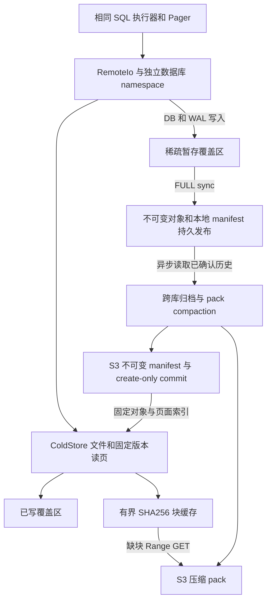

# Turso WAL Pageserver 完整读写路径与官方用例验证

2026-10-10 使用固定 Turso 提交 `8cc059bd951551ae4b9dc31c01146a24b3e87a51` 完成可写对象存储链路验证。官方 SQL、矩阵、EXPLAIN 预期和上游源码保持原样，新增存储 backend 与测试工具位于实验目录。当前支持在线缺块读取、继续写入、checkpoint/VACUUM、归档、pack compaction 和恢复；Keeper 与自动节点切换仍是后续阶段。

## 验收结果与边界

| 完整原样批次 | 总数 | 通过 | 失败 | 错误 | 跳过 |
| --- | ---: | ---: | ---: | ---: | ---: |
| 官方 Rust 原始 backend | 20905 | 20559 | 0 | 0 | 346 |
| ColdStore 内存对象后端 | 20905 | 20559 | 0 | 0 | 346 |
| ColdStore 阿里云 S3 兼容后端 | 20905 | 20559 | 0 | 0 | 346 |

每批完整加载 `sqlite-sqltests` 和 `turso-sqltests`，包括 419 个新增纳入验收的 EXPLAIN 快照。显式引用其他 journal mode 的 74 个用例按 WAL 范围排除。配置 `SnapshotUpdateMode::No`，不更新预期文件；启用 SQLite CLI 的 `@cross-check-integrity`，关闭时把实际虚拟文件实体化交给官方 runner。未产生快照新建或更新，标准与云端逐例结果无额外差异。

官方 Rust backend 未声明 STRICT 能力，因此原始批次中的 342 个用例被跳过。单独增加能力声明后，原始 backend、内存 ColdStore 和实际 OSS ColdStore 的同一 342 个用例全部通过，SQL 与期望未改。

其余四个上游显式 TODO 跳过项也单独执行：两个生成列 DELETE/UPSERT 用例已能原样通过；`gencol_vacuum_virtual` 和 `gencol_vacuum_virtual_with_index` 的内存库版本在标准和云端路径均返回 `cannot VACUUM an in-memory database`。将诊断批次的数据库位置改成 TempFile 后，四个用例全部通过，包括这两个持久库 VACUUM 场景。

因此，共 20,903 个 WAL 用例在补充批次中按原始数据库语义通过；两条原样内存 VACUUM 仍受上游功能限制，不能说原始语料零跳过全绿。持久库对应场景均通过，云端没有新增失败。原样诊断保留两条失败及非零退出，文件模式诊断另存证据，没有删除断言或修改预期。

| 存储验证 | 内存对象后端 | 实际 S3 兼容内网 |
| --- | ---: | ---: |
| 冷读写、事务确认前后故障、恢复和缓存边界 | 23 组通过 | 23 组通过 |
| 多库 pack、归档发布、compaction 与无本地文件恢复 | 24 组通过 | 24 组通过 |

原有 10 组 WAL/页面、2 个反例检查和 5 组代际测试也通过。上述范围是 Rust SQL corpus 与存储故障验证，没有把 CLI 点命令、TCL、所有语言 binding、完整 Rust integration 或分布式 simulator 算入验收。

## 实际读写路径

| 操作 | 存储行为 |
| --- | --- |
| 空库与首次初始化 | 可归档零字节 DB，page_count 保持 0；不预先写 user_version。首次 DB header sync 发布初始化代际，保存选择的 page_size 并保留空版本。已有 fixture 的元数据保持原值 |
| 普通缺页 | 覆盖区已有字节直接返回；其他旧字节从对应不可变对象的 64 KiB 块读取。块缓存缺失时根据 manifest extent Range GET，解压并验 SHA256 后安装 |
| 固定版本读者 | 页面索引绑定代际、frame、dbsize 和 WAL offset；未更新页使用该代际基线。创建连接时无需下载完整 DB/WAL 来建立服务端索引 |
| 可写冷启动 | DB/WAL 大小来自目录，稀疏文件只记录覆盖字节。未读取的旧洞必须咨询远端；新增长或截断后重新增长的区域才能为零 |
| FULL 提交 | WAL 写入完成后，sync Completion 等待远端实体化、fsync、不可变对象和本地 manifest 发布。普通 WAL 更新复用基线对象。确认仅覆盖本地 Pageserver，S3 发布异步进行 |
| NORMAL/OFF | 保留引擎的较弱同步语义。NORMAL checkpoint 的 WAL/DB 同步可以发布完整前缀；这版引擎对 OFF 未同步回填返回 busy。崩溃可丢失完整未确认尾部，恢复不安装部分事务 |
| checkpoint、TRUNCATE、RESTART 和 VACUUM | DB sync 后校验完整覆盖已发布版本；发布新基线及覆盖位置后再允许 WAL 截断或 salt 重用。旧对象与各代版本保留 |
| ATTACH | 持久保存辅助 DB/WAL 的对象对，支持 checkpoint、重启、重新归档、完整恢复与可写冷启动。用于查询的 fixture 也通过对象存储读取 |
| 异步归档和 compaction | 从原子 manifest 与不可变对象取快照，不锁住运行中的 SQL 文件。pack 整理在发布前检查输入 revision，过期则重试，旧目录与对象保留 |
| 本地重启 | 丢弃未确认覆盖区，恢复本地已发布 manifest；固定的 cold-bootstrap 保留原始远端对象引用，即使新的 compaction 目录不再列出旧 WAL 对象 |
| 远端失败与损坏 | 请求失败，不用零字节替代未取回的旧页；错误块不安装缓存。缓存损坏可重新取回并核验，同一块的并发缺失请求合并 |

磁盘块缓存默认每个共享目录 128 MiB，进程内块缓存共 128 MiB。冷点查只缓存 86,168 字节，基线为 2,105,344 字节；启动没有数据块 Range GET。全扫描、DB sync 和 checkpoint 仍可能读取整个基线；Turso 可写打开仍可能读取当前 WAL 建立自己的索引。这些成本没有被当成点查的按需读取成果。

新 test backend 保留逻辑 `:memory:` 名称，同时把物理文件放入独立 namespace，修复此前强制文件化产生的四个 database_list 偏差。计算 spill 和 VACUUM 的临时文件使用原生 IO。`@database readonly` 与原始 Rust backend 一样不应用为打开权限；固定版本读实验另用真正 ReadOnly 标志并验证拒绝写入。

## 目录和恢复一致性

归档 manifest 同时保存各代对象、对象分块、页面号到 WAL offset 索引及辅助文件引用。read、restore、归档和 compaction 都使用明确对象 key，无 LIST 或外部数据库操作。CURRENT 是提示；连续、带前驱摘要的不可变 commit 决定已发布目录。

本地根记录对象存储绑定，不包含凭证。切换 service、endpoint、bucket、prefix、region 或数据库历史时不能静默复用旧缓存和本地确认状态。读者继续使用固定目录；旧 pack/commit/manifest 未开启 GC，异步 compaction 不删除长读所需对象。恢复到旧 revision 后写入应使用新的历史/前缀并隔离旧写入者。

文件锁仍为空实现，每库只有一个计算写入者；没有 Keeper、自动接管、丢回复请求去重或长期 GC。FULL 不是 quorum 或 S3 同步确认。当前 pack compaction 只重排压缩块，不生成独立 image/delta 层，也没有任意时间点索引。页面索引和整批打包仍需容量管理，pack 上限 64 MiB。

## 复现与证据

在 [实验目录](../README.md) 执行 `./run-cloud-e2e.sh`，加 `--oss` 使用已授权的实际内网对象存储。凭证只从环境读取。完整 runner 使用非 debug hash join 预算，与官方 CI/release 快照一致；debug 的 32 KiB 预算会产生 12 个标准基线快照差异，不能修改预期来掩盖。

官方批次为隔离用例逐例创建归档目录，其请求数量不能作为生产跨库合并上传的成本；多库合包另由归档测试验证。

测试保留逐例 JSONL、跳过原因、RPC/对象操作统计和独立前缀。失败、错误、新快照或更新快照均使普通验收返回非零；诊断的已知内存 VACUUM 失败由汇总脚本按精确名称和错误逐项核对，其他失败不能通过。

- [内存对象链路最终验收](evidence/cloud-acceptance-memory-latest.json)
- [实际 S3 兼容链路最终验收](evidence/cloud-acceptance-oss-latest.json)
- [完整 OSS 官方批次](evidence/full-cloud-oss-latest.json)
- [OSS STRICT 补充](evidence/strict-cloud-oss-latest.json)
- [原样 TODO 诊断与失败](evidence/skipped-cloud-oss-latest.json)
- [持久库 TODO 诊断](evidence/persistent-skipped-cloud-oss-latest.json)
- [OSS 冷读写与恢复边界](evidence/cold-oss-latest.json)
- [OSS pack 归档与 compaction](evidence/archive-oss-latest.json)
- [旧版 10 月 9 日批次](evidence/compatibility-summary.json)

## 当前验证入口

服务位于 `pageserver/`，`build.sh` 构建 `bin/pageserver` 与 `bin/verify`。`run.sh` 覆盖 10 + 2 + 5 组本地验证，`run-storage-tests.sh` 覆盖 24 组归档与 23 组冷读写；替换入口后已重新通过。`run-cloud-e2e.sh` 执行完整验收，`bin/verify summary` 按用例身份与数量核对覆盖率，缺失检查、额外失败或快照变化均不能通过。

此前完整内存和实际 S3 语料证据保留原始运行来源。新入口重新验证安全检查与官方子集，并用新汇总工具核对旧完整 JSONL；这不表示重新运行了全部语料。

存储保留文件、对象和目录的 POSIX fsync 屏障，硬件断电未验证。独立 worker 从固定 cold-bootstrap 绑定读取旧对象，使用自己的临时缓存，不重开引擎或改变活跃稀疏文件。
