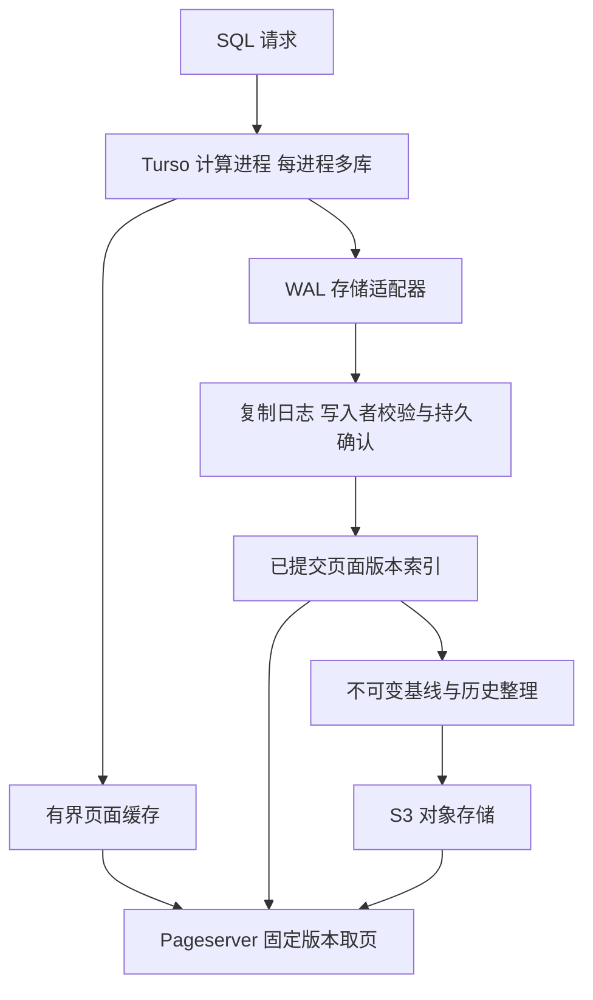

# Turso WAL Pageserver 接入调研与实验

Turso WAL 模式可以接入自建 Pageserver。本地原型已经使用真实 Turso 引擎完成远程按需读页、远程提交确认、固定版本查询和强杀后恢复，未修改上游引擎源码。引擎接入的难度较低；具备节点故障持久性、主节点接管和历史保留的存储服务仍是一项独立工程。

当前方案采用每库一个计算写入者、多个库共享进程、版本化页面和复制 WAL。数据库使用普通 WAL 模式，同库写事务由引擎串行协调；扩大写入容量主要依靠不同数据库分片。初轮实验于 2026 年 10 月 8 日完成；10 月 10 日补齐在线对象缺页读取、可写冷启动与恢复，并完成标准、内存对象和实际 OSS 链路的 20,905 例官方 WAL SQL 对照。补跑后 20,903 个原始用例通过；两条上游内存 VACUUM 限制及通过的持久库变体单独记录，见 [官方用例兼容性验证](turso-wal-pageserver-compatibility.md)。

参考 Neon 的目标部署方案见 [Keeper 与 Pageserver 切换及 S3 布局设计](turso-pageserver-keeper-s3-design.md)，包含列表下发、成员变更、写入者与页面发布隔离、image/delta 层、manifest 发布和历史回收。该部分是协议设计，现有本地实验尚未实现分布式切换。

当前首版范围见 [跨库归档与元数据库设计](turso-pageserver-pack-metadata-design.md)：单 Pageserver 本地确认、跨库 pack 异步落 S3、目录以原子创建的不可变 commit 发布，外部数据库只承担节点和放置管理。正常读写、归档和 compaction 不访问外部数据库；本地盘永久丢失时允许恢复到 S3 已发布的完整事务前缀。

## 源码接入点

检查并编译的 Turso 提交为 `8cc059bd951551ae4b9dc31c01146a24b3e87a51`，提交日期为 2026 年 10 月 7 日。该源码的 Cargo package version 为 `0.8.0`，实验使用这个固定源码编译结果，与已有实验中的预编译 CLI 0.8.1 分开记录。

| 接口 | 作用与接入判断 |
| --- | --- |
| `DatabaseStorage` | 提供页读取、页写入、文件大小、截断和 sync；源码注释明确将 remote page server 列为可能实现 |
| `IO` 与 `File` | 提供文件打开及 `pread/pwrite/sync`；可以同时替换主库、WAL 和临时文件后端 |
| `Completion` | 存储操作可以返回未完成对象；引擎等待完成后继续运行 |
| `OpenOptions::storage` | 可以传入预打开的主文件存储；本原型通过正式 `Database::open` 入口注入 |
| partial sync | 已有按 `server_revision` 选择页面、按需取页的实现，可作为批量取页和缓存的参考 |

来源：[页面存储接口](https://github.com/tursodatabase/turso/blob/8cc059bd951551ae4b9dc31c01146a24b3e87a51/core/storage/database.rs#L106)、[IO 与 File 接口](https://github.com/tursodatabase/turso/blob/8cc059bd951551ae4b9dc31c01146a24b3e87a51/core/io/mod.rs#L153)、[打开数据库](https://github.com/tursodatabase/turso/blob/8cc059bd951551ae4b9dc31c01146a24b3e87a51/core/database.rs#L1218)、[按版本取页](https://github.com/tursodatabase/turso/blob/8cc059bd951551ae4b9dc31c01146a24b3e87a51/sync/engine/src/database_sync_operations.rs#L2209)。

SQLite WAL frame 保存完整页面镜像，commit frame 中的数据库页数标记事务结束。存储层可以按页面号和提交位置建立索引，不需要执行 PostgreSQL 的 WAL redo。Neon 的页面服务处理 PostgreSQL WAL、relation 和 LSN，不能直接连接 Turso；可借鉴它的日志持久化、页面整理和对象存储分工。[Turso WAL 说明](https://github.com/tursodatabase/turso/blob/8cc059bd951551ae4b9dc31c01146a24b3e87a51/docs/agent-guides/transaction-correctness.md)、[Neon Pageserver 存储](https://github.com/neondatabase/neon/blob/main/docs/pageserver-storage.md)。

## 实验实现与结果

实验目录为 [turso-serverless](../README.md)。Rust 适配器把主库和 WAL I/O 送往独立 TCP 服务。计算进程仅持有内存状态，不创建本地主库或 WAL 文件。读写请求使用阻塞 RPC并按文件复用连接，sync 在后台线程执行并返回 pending Completion；临时 spill 和 VACUUM 工作文件留在计算节点。这验证了提交等待接口，不代表完整的异步网络后端。

存储服务维护暂存 DB/WAL，将各代基线与已确认 WAL 保存为 SHA256 命名的不可变对象，经 fsync 和原子替换发布 manifest。manifest 保存对象引用、提交边界及新基线覆盖的上一代位置，恢复时重建权威 DB/WAL 和页面索引；`baseline.db`、`acked.wal` 只是调试兼容副本。服务通过固定版本读请求即时组合页面，没有为每个查询下载完整数据库。

本轮 10 组正向实验与两个故意错误的实现检查均通过，原始结果见 [WAL 实验结果](evidence/latest.json) 与 [反例检查结果](evidence/negative-controls.json)。

| 验证 | 实测结果 |
| --- | --- |
| 冷点查与缓存 | 基线 2,105,344 字节；包括打开数据库的冷点查读取 30,720 字节，覆盖 3 个不同页面位置；同连接重复点查无远程主文件读取 |
| 全表扫描 | 读取约 2.09 MB；按需读取不会消除全扫描的传输成本 |
| 固定版本查询 | 基线及两个提交版本分别返回正确的行数、更新内容；savepoint 回滚数据未出现，三个版本均通过 integrity_check |
| 提交屏障 | 暂停存储确认时，COMMIT 尚未返回，页面服务未发布新版本；完成持久化后才确认并发布 |
| 长读事务与 checkpoint | 同一引擎内旧读事务跨新提交和 PASSIVE checkpoint 仍看到旧内容，新读事务看到更新 |
| WAL 尾部处理 | 截断、校验和损坏和缺少最终 commit frame 时，解析器不发布不完整事务 |
| 进程强杀 | 强杀计算与存储进程后，从服务端文件恢复 513 行，同时保留此前 512 行的旧页面版本 |
| 确认前失败 | 客户端收到错误；原始暂存 WAL 有 3 个 commit marker，权威 WAL 只有 2 个；重启未恢复失败写入 |
| 确认后丢回复 | 客户端收到错误，重启后写入仍存在；错误不能等同于已回滚 |
| 同步模式与 WAL 复用 | 在已初始化 WAL 上，NORMAL 单次提交没有 WAL sync，FULL 有一次；TRUNCATE 后重新写入形成新的 WAL salt |

两个反例证明检查能够识别关键错误：让旧快照读取最新页面，旧版本的行数从 512 错成 513；让恢复直接相信暂存 WAL，确认前失败的记录被错误恢复。

单次延迟探针向每次远程读增加 0、1、5 ms 延迟，点查耗时分别约 1.1、3.8、13.7 ms，打开阶段均记录到 11 次主文件读取。它只展示串行缺页的往返成本，不能作为吞吐量或 P99 基准。

## WAL 存储协议

提交时，适配器先写入暂存 frame；存储服务校验 WAL header、salt、连续校验和、frame 范围和 commit marker，持久化完整事务后推进权威提交位置。`File::sync` 的 Completion 必须等待满足故障模型的远程确认。配置使用 `synchronous=FULL`；不能把 NORMAL 的普通写入完成当作每事务远程持久化确认。[Turso 提交 sync 状态机](https://github.com/tursodatabase/turso/blob/8cc059bd951551ae4b9dc31c01146a24b3e87a51/core/storage/pager.rs#L4732)。

读请求携带固定快照身份与数据库大小。Pageserver 返回不晚于该快照的页面镜像，并从兼容基线补足尚无新 frame 的页面。页面缓存键包含数据库身份、历史和版本；旧快照不能通过裸页面号命中更新后的页面。写入者可读取自己的未提交 frame，对外读副本只使用权威提交前缀。

建议的第一版接口为：

| 接口 | 契约 |
| --- | --- |
| `CommitWal(db, history, owner_epoch, wal_generation, request_id, previous_position, bytes)` | 校验合法写入者与连续提交，持久化并去重，返回权威位置 |
| `GetPages(db, history, snapshot, page_numbers)` | 按固定提交快照返回完整页面及数据库页数 |
| `ReadWal(db, history, from, to)` | 返回连续已确认历史；缺失或损坏必须报错 |
| `PublishBaseline(db, history, covers_position, manifest)` | 原子发布覆盖指定提交位置的不可变基线 |
| `GetRequestResult(db, request_id)` | 查询丢回复请求的持久化结果，避免重放非幂等 SQL |

这里的接口是自建协议。S3 可以异步归档；在对象存储完成归档和合法基线覆盖之前，复制日志仍是持久数据，不能作为缓存删除。

## 生产化边界与后续验收

当前 PoC 的文件锁为空实现，只适用于一个计算写入者；本地文件 fsync 和同机进程强杀也不能证明存储节点丢失时不丢数据。生产实现需要成熟复制后端、存储路径上的 owner fencing，以及满足所选故障模型的确认策略。

本原型每次确认复制整个 WAL，每个页面版本在内存保存映射，适合验证正确性。生产实现应使用增量事务记录、页面索引和有界缓存；已补充文件连接复用和读写超时，RPC 仍需要连接池、批量预取、取消与并发预算。

本原型已支持多个 WAL 代际。TRUNCATE/VACUUM 和 RESTART 复用前，服务端校验已同步 DB 完整覆盖已发布版本，持久化新基线和 manifest 后再允许换代；旧代基线和 WAL 保留，快照身份包含代际与 frame。新增 5 组实验验证连续 VACUUM 后写入、元数据与自增序列、跨 5 代的 8 个页面快照和进程重启读取，见 [跨代际结果](evidence/generation-latest.json)。裸 frame number 不能跨 WAL reset、数据库恢复或重建比较；历史读者需要 pin，GC 只能删除没有合法引用的历史。

损坏尾部实验验证的是解析规则。若损坏发生在已经确认的历史内，生产恢复必须明确失败，不能把解析器停止位置当作较早成功提交。权威元数据应保存目标提交位置、范围和摘要，恢复完成后核对实际覆盖。

10 月 10 日已将不可变基线/WAL 接入 S3 SDK 归档，并提供按需 S3 缺块读取与可写冷启动。远端目录使用原子创建 commit 发布，CURRENT 只帮助定位；FULL 确认目前仍仅保证单 Pageserver 本地发布，归档异步进行。下一阶段将代际发布、写入者隔离与恢复协调接入 Keeper，继续验证节点丢失、网络分区、旧主复活和丢回复去重。之后使用明显大于缓存预算的数据库，以及目标活跃库规模，测量冷启动、提交与缺页延迟、内存、FD 和复制积压。当前实验没有验证 10 万库容量。

权威发布路径原先失败的 3 个官方 VACUUM 用例已通过代际切换修复，事务/回滚/savepoint/VACUUM 配对批次 59 个用例全部通过。另一个实验复现 NORMAL 的 INSERT 返回成功而没有发布页面版本，强杀恢复只包含此前 FULL 确认的行。生产接入仍需解决 FULL 约束和上述协调、恢复与对象存储边界，不能只引用 SQL 通过数。
